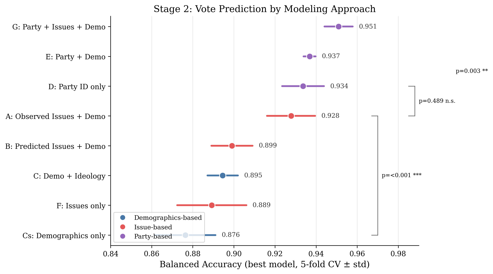
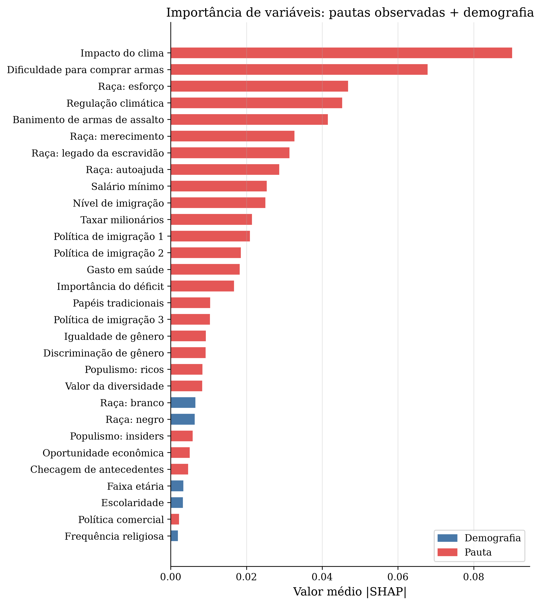

# What Drives the Vote? Issue Positions vs. Demographics in the 2024 U.S. Election

Code and results for my undergraduate thesis, *Modeling Patterns of Political Opinion from Ideological Issues*.

## Research question

How well do people's positions on specific issues, such as climate, guns, immigration, and race, predict their 2024 presidential vote, compared with their demographics and party identification? And can demographics alone predict those issue positions?

## Data

The [American National Election Studies (ANES) 2024 Time Series](https://electionstudies.org/data-center/2024-time-series-study/), a national survey of U.S. adults. After cleaning, the vote models use about 3,600 respondents who voted for Harris or Trump, with 10 demographic variables, party identification, ideology, and 28 issue questions. Survey weights are applied throughout.

## Method

A two-stage pipeline:

1. **Stage 1:** predict each issue opinion from demographics only.
2. **Stage 2:** predict the vote from different feature sets: demographics only, demographics plus ideology, issues only, issues predicted in Stage 1, party only, and combinations.

Each setup is compared across logistic regression (elastic net), random forest, and XGBoost with stratified 5-fold cross-validation. Stage 1 is retrained inside each outer fold to avoid leakage. Models are tuned with Optuna, compared with paired bootstrap and McNemar tests, and explained with SHAP values and feature ablation.

## Key findings

- Issue positions alone predict the vote with **0.89 balanced accuracy**, far above demographics alone (**0.66**) and above demographics plus ideology (**0.83**).
- Party identification is still the single strongest predictor (**0.93**). Adding issues and demographics raises this only slightly.
- Demographics are weak predictors of issue opinions. Issues predicted from demographics add nothing over demographics alone, so issue positions carry information that demographics do not.
- The most influential issues are the perceived impact of climate change, gun purchase rules, and attitudes about racial inequality.



*Balanced accuracy of the vote model (XGBoost, 5-fold CV) for each feature set. Purple: party-based, red: issue-based, blue: demographic-based.*



*Mean absolute SHAP value per feature in the issues plus demographics model. Red bars are issues, blue bars are demographics.*

Figure labels are in Portuguese, the language of the thesis.

## Run it

```bash
pip install -r requirements.txt
python prepare_anes.py
python train_pipeline.py
python generate_figures.py
```

`prepare_anes.py` cleans the raw ANES file, `train_pipeline.py` runs both stages and writes metrics to `results/`, and `generate_figures.py` draws the charts in `figures/`. Extra analyses cover hyperparameter tuning (`tune_stage2.py`), pre-election vote intent (`run_voter_intent_analysis.py`), and political independents (`run_independent_subgroup_analysis.py`).

## Tech stack

Python, pandas, scikit-learn, XGBoost, Optuna, SHAP, SciPy, and Matplotlib.
